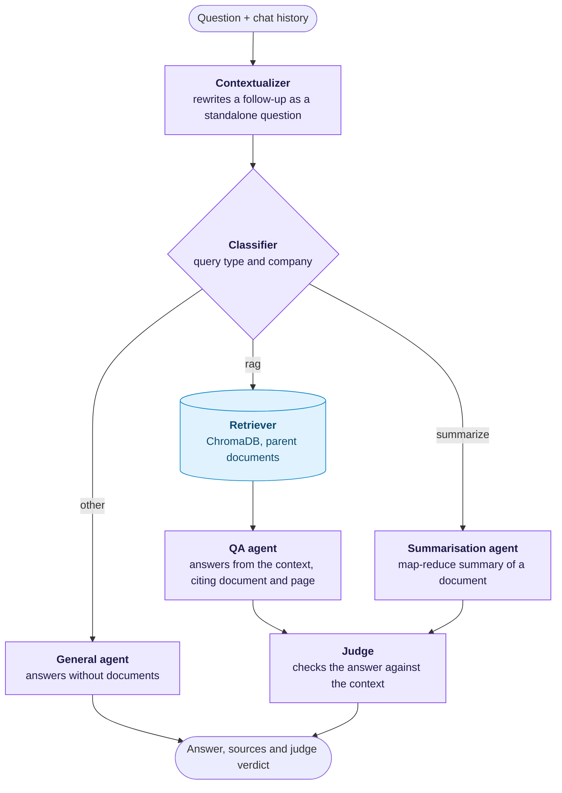

## Overview

This project provides a robust Document Chatbot utilizing a **FastAPI** backend and a **React (Vite)** frontend. It leverages **LangGraph** for orchestrated agent workflows and **RAGAS** for automated evaluation of retrieval and generation quality.

### Key Features

- 📤 **Multi-Document Upload**: Upload multiple PDF documents (e.g., Apple, Uber, Volkswagen financial reports) for indexing.
- 💬 **Intelligent Chat**: Ask complex questions and receive context-aware answers citing specific documents.
- 🕵️ **Agentic Workflow**: Uses a graph of agents (Classifier, Retriever, Summarizer, Judge) to handle different query types.
- ⚖️ **Automated Evaluation**: Integrated **RAGAS** suite to audit response quality (faithfulness, relevancy, correctness) against ground truth.
- 📝 **Judge Feedback**: Real-time feedback from a "Judge" agent on the quality of the generated answer.
- 🔍 **Tracing**: Optional **MLflow** traces of every chat request (prompts, retrieved chunks, answers).

---

## Architecture

The system uses a sophisticated agent workflow:



Purple steps call the LLM; the blue step searches the vector store. The diagram mirrors the graph in
`backend/app/services/workflow/builder.py`.

1.  **Contextualizer**: Rewrites a follow-up question into a standalone one using the chat history.
2.  **Classifier**: Routes the query to retrieval (RAG), summarization or a general answer.
3.  **Retriever**: Fetches relevant chunks from ChromaDB (parent-document retrieval).
4.  **QA / Summarization**: Writes the answer from the retrieved context, citing document and page.
5.  **Judge**: Verifies the answer against the retrieved context before returning it to the user.

The prompt-injection check (`injection_agent` in the diagram) is currently disabled; see `app/services/workflow/builder.py` to re-enable it.

---

## Project Structure

```
Document-QA/
├── backend/                    # FastAPI Backend
│   ├── app/                    # Main application package
│   │   ├── api/                # API layer
│   │   │   └── routers/        # API route handlers
│   │   │       ├── chat.py     # Chat endpoints
│   │   │       ├── documents.py # Document upload
│   │   │       └── evaluation.py # RAGAS evaluation
│   │   ├── core/               # Core configuration
│   │   │   └── config.py       # Environment variables
│   │   ├── models/             # Data models
│   │   │   └── schemas.py      # Pydantic schemas
│   │   ├── services/           # Business logic
│   │   │   ├── workflow/       # LangGraph agents
│   │   │   │   ├── agents.py   # Agent implementations
│   │   │   │   ├── graph.py    # Workflow graph
│   │   │   │   └── chat.py     # Chat service
│   │   │   ├── rag/            # RAG functionality
│   │   │   │   └── indexing.py # Chunking and indexing
│   │   │   └── evaluation/     # Evaluation
│   │   │       ├── eval_set.json # 30 questions with ground truths
│   │   │       ├── ragas.py    # RAGAS metrics
│   │   │       ├── run.py      # Evaluation runner (logs to MLflow)
│   │   │       └── dataset.py  # MLflow evaluation dataset
│   │   ├── main.py             # FastAPI app entry
│   │   └── utils.py            # Shared utilities
│   ├── data/                   # Local data (not in git)
│   │   ├── chroma_db/          # Vector database
│   │   ├── doc_store/          # Parent-document store
│   │   └── mlflow/             # MLflow runs, traces and datasets
│   ├── prompts/                # YAML prompt templates
│   │   ├── rag_core.yml        # Core RAG prompts
│   │   └── rag_eval.yml        # Judge prompt
│   ├── scripts/
│   │   └── mlflow-server.sh    # MLflow UI and tracking server
│   ├── tests/                  # Test files
│   └── pyproject.toml          # Python dependencies
├── frontend/                   # React + Vite Frontend
│   ├── components/             # React components
│   ├── services/               # API client
│   ├── App.tsx                 # Main app component
│   └── package.json            # Node dependencies
├── notebooks/                  # Retrieval and chunker comparison
├── .github/workflows/          # CI: Docker builds and tests
├── docker-compose.yml          # Docker orchestration
└── .env                        # Environment variables
```

---

## Prerequisites

Ensure the following are installed:

- **Docker** & **Docker Compose**
- **Python 3.11+** and **[uv](https://docs.astral.sh/uv/)** (for local dev)
- **Node.js 18+** (for local dev)

---

## Setup and Run

### 🐳 Using Docker (Recommended)

1.  **Clone the repository**
    ```bash
    git clone <repo-url>
    cd document-qa
    ```

2.  **Environment Setup**
    - Create a `.env` file in the root directory.
    - Add your API keys:
      ```env
      OPENAI_API_KEY=your_key_here
      OPENAI_MODEL_NAME=gpt-4o
      EMBEDDING_MODEL=text-embedding-3-small
      HF_TOKEN=your_huggingface_token_if_needed  # only for the injection check, currently disabled
      ```
    - Optional: `CORS_ORIGINS` (comma-separated origins allowed to call the API) and
      `MLFLOW_TRACKING_URI` (see step 5).

3.  **Run the Application**
    ```bash
    docker-compose up --build
    ```

4.  **Access the App**
    - **Frontend**: [http://localhost:5173](http://localhost:5173)
    - **Backend API**: [http://localhost:8000/docs](http://localhost:8000/docs)

5.  **Trace requests (optional)**
    Start the MLflow server on the host, before or after `docker-compose up`:
    ```bash
    backend/scripts/mlflow-server.sh
    ```
    Every chat request is then traced to the `document-qa-app` experiment at
    [http://localhost:5001](http://localhost:5001), next to the evaluation runs. If the server is not
    running when the backend starts, the backend logs a warning and runs without tracing;
    restart the backend once the server is up.

### 💻 Local Development

**Backend**:
```bash
cd backend
uv sync
uv run uvicorn app.main:app --reload --port 8000
```
To trace requests, start `scripts/mlflow-server.sh` and set `MLFLOW_TRACKING_URI=http://localhost:5001` in `.env`.

**Frontend**:
```bash
cd frontend
npm install
npm run dev
```

---

## Evaluation Suite

The evaluation runs the 30 questions in `backend/app/services/evaluation/eval_set.json` (over
`apple.pdf`, `uber.pdf` and `volkswagen.pdf`) through the workflow and scores them with **RAGAS**.
Index those three documents first.

### From the UI

1.  Navigate to the **Evaluations** tab in the UI.
2.  Click **"Start Document Audit"**.
3.  View detailed metrics:
    - **Faithfulness**: Is the answer derived from context?
    - **Answer Correctness**: Does it match ground truth?
    - **Context Recall**: Did we retrieve all necessary info?

A run takes many minutes, so the backend runs it as a background job: `POST /evaluate` starts it
(one run at a time) and `GET /evaluate` returns its status and results, which the frontend polls.
Chat keeps working meanwhile. A metric RAGAS could not score comes back as `null` and is hidden.

### From the command line (with MLflow)

```bash
cd backend
uv run python -m app.services.evaluation.run   # run the eval set and log it to MLflow
scripts/mlflow-server.sh                       # browse the runs at http://localhost:5001
```

Each run is logged to the `document-qa-eval` experiment with per-category metrics, refusal
accuracy, the per-question results and a link to the `document-qa-eval-set` evaluation dataset.

---

## Tests and CI

```bash
cd backend
uv run pytest -m "not integration"   # offline tests, no API keys needed
uv run pytest -m integration         # calls OpenAI, needs OPENAI_API_KEY in .env
```

On every pull request and push to `main`, GitHub Actions builds both Docker images and, once they
build, runs the offline tests (`.github/workflows/tests.yml`).

---

## Demo

<video src="backend/outputs/screen_docuAIapp.mov" controls="controls" style="max-width: 100%;">
  Your browser does not support the video tag.
</video>

---

## Future Work

**Speed and user experience**
- **Stream answers.** Add a streaming chat endpoint (server-sent events via LangGraph's `astream`)
  that sends step progress ("Searching uber.pdf…"), the sources and the answer tokens as they are
  generated, with the judge's verdict arriving last as a badge. Today the UI waits for the whole
  run. Traces show most of the wait is classification and retrieval, so progress updates matter
  more than token streaming for short answers; the open design question is how to flag an answer
  the judge rejects after the user has already read it.
- **Remove the slow first request.** The first chat after startup spent 38 s in retrieval (later
  requests: 2–4 s), most likely loading the index and the embedding client. Load them at startup.

**Answer quality**
- **Judge false negatives.** The judge marked a correct answer (eval question `apple-09`) as invalid.
- **Classifier routing.** 2 of the 30 eval questions were sent down the wrong path; the traces in
  MLflow show the classifier's input and output for each.
- **Prompt-injection check.** The check is disabled in the graph (see Architecture). Re-enabling it
  needs `HF_TOKEN`; it calls HuggingFace inference and fails closed (blocks every query) when that
  service is down.

**Frontend and deployment**
- **Production frontend.** Serve a built frontend with nginx and proxy `/api` to the backend,
  instead of the Vite dev server. The API URL is hard-coded in `frontend/services/api.ts`
  (`VITE_API_URL` in `docker-compose.yml` is ignored), and a same-origin proxy would remove the
  need for CORS.
- **Frontend type errors and CI.** `App.tsx` has type errors (`tsc --noEmit`); fix them and add a
  frontend type check to CI.
- **Durable evaluation jobs.** The UI's evaluation job lives in memory, so a backend restart loses
  a run in progress, and it is not logged to MLflow (only the command-line runner is).
